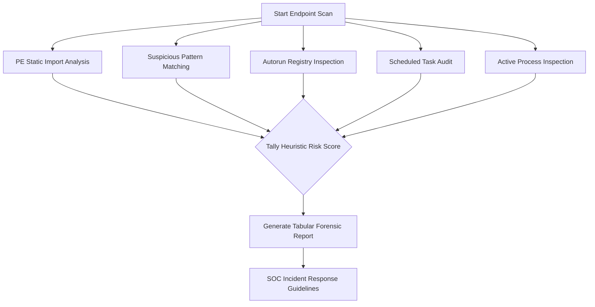

# 🛡️ Enhanced Keylogger & Spyware Detector

[](https://python.org)
[](https://csrc.nist.gov/)
[](https://microsoft.com)
[](LICENSE.txt)

A proactive endpoint defense and static/runtime malware analysis tool developed in Python. Designed for security analysts, incident responders, and system administrators to uncover stealthy keyloggers, keyboard surveillance hooks, and unauthorized surveillance persistence across Windows endpoints.

---

## 📌 Threat Context & Motivation

Keyloggers are stealthy malware or spyware designed to intercept keystrokes, capture sensitive credentials (passwords, PINs, banking info), and record keystroke cadence. They often evade standard antivirus scanners by operating as user-mode hooks or living-off-the-land utilities.

This tool implements multi-vector defensive heuristics to hunt down:
1. **Low-Level Hook Invocations:** Executables importing Windows User32/Kernel32 keyboard hooking APIs.
2. **Suspicious Naming Patterns:** Executables masquerading under known surveillance keywords.
3. **Registry Persistence:** Unauthorized keys in Windows `Run` / `RunOnce` registries.
4. **Scheduled Task Persistence:** Suspicious tasks scheduled for automated elevation.
5. **Active Process In-Memory Inspection:** Running processes tied to hooking signatures.

---

## 🔍 Detection Vectors & Heuristics



### Monitored Windows API Hook Signatures
- `GetAsyncKeyState` / `GetKeyState` — Polling keystroke hardware states asynchronously.
- `SetWindowsHookEx` (`WH_KEYBOARD`, `WH_KEYBOARD_LL`) — Registering global keyboard input hooks.
- `CallNextHookEx` — Passing intercepted keystrokes down the chain.
- `GetKeyboardState` — Dumping total keyboard virtual-key state buffers.
- `RegisterHotKey` — Intercepting custom hotkeys and system events.
- `GetForegroundWindow` / `GetWindowText` — Correlating keystrokes to target window titles (e.g. browser banking tabs).

---

## 📂 Project Structure

```text
Enhanced-Keylogger-Detector/
├── main.py              # Primary detection engine & CLI scanner
├── requirements.txt     # Python runtime dependencies (pefile, psutil, tabulate)
├── sample_report.txt    # Example forensic output and triage report
├── LICENSE.txt          # MIT Open Source License
├── .gitignore           # Git ignore configuration
└── README.md            # Comprehensive project documentation
```

---

## 🚀 Installation & Setup

### Prerequisites
- **Operating System:** Windows 10 / 11 / Server (or Windows VM for malware analysis)
- **Python:** 3.8+ (x64 recommended)
- **Privileges:** Administrator Command Prompt or PowerShell (required to read protected processes and registry keys)

### Step 1: Clone the Repository
```bash
git clone https://github.com/<your-username>/Enhanced-Keylogger-Detector.git
cd Enhanced-Keylogger-Detector
```

### Step 2: Create a Virtual Environment & Install Dependencies
```powershell
python -m venv venv
.\venv\Scripts\activate
pip install -r requirements.txt
```

---

## 💻 Usage Instructions

### Scan Default Directory (Current Working Directory):
```powershell
python main.py
```

### Scan High-Risk Directories:
Malware frequently stages in temporary and public folders:
```powershell
python main.py --paths "C:\Users\Public" "C:\Windows\Temp" "C:\Users\<User>\AppData\Local\Temp"
```

### Scan Specific Executable:
```powershell
python main.py --paths "C:\Path\To\Suspicious\App.exe"
```

---

## 📊 Sample Output & Forensic Report

```text
============================================================
              KEYLOGGER DETECTION FORENSIC AUDIT
============================================================
Target Path: C:\Users\Public
Timestamp:   2026-11-03 08:15:00

[!] Suspicious File Identified:
    Path: C:\Users\Public\spytool.exe
    Size: 120 KB
    Flags:
      - Matched Keyword: 'spy'
      - Imported Hook API: GetAsyncKeyState, SetWindowsHookExW
    Risk: HIGH

[!] Active Process Anomaly:
    PID: 4520
    Process Name: spytool.exe
    Path: C:\Users\Public\spytool.exe
    Active Thread Hooks: Detected

[!] Registry Persistence:
    Key: HKLM\Software\Microsoft\Windows\CurrentVersion\Run
    Value: SpyService -> "C:\Users\Public\spytool.exe"
```

---

## 🛠️ Recommended Incident Response Steps

When a file or process is flagged:
1. **Do not immediately terminate blindly:** Calculate SHA-256 hash and query VirusTotal or internal threat intelligence feeds.
2. **Quarantine:** Isolate the binary into a password-protected zip for dynamic sandbox analysis (e.g. Any.Run, Cuckoo).
3. **Eradicate Persistence:** Remove corresponding registry `Run` entries and associated scheduled tasks.
4. **Remediate Credentials:** Reset any credentials that were typed on the affected workstation during the compromise window.

---

## ⚠️ Disclaimer

This tool is strictly designed for **defensive security auditing, system administration, and educational research**. It must only be used on systems where you have explicit authorization. The authors assume no liability for misuse.

---

## 📄 License

Licensed under the [MIT License](LICENSE.txt).
